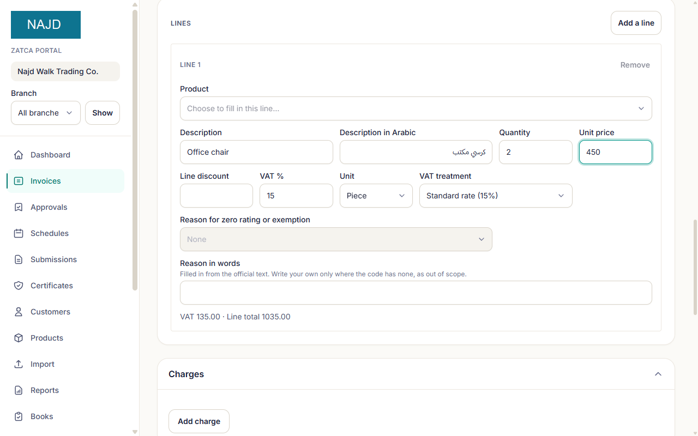
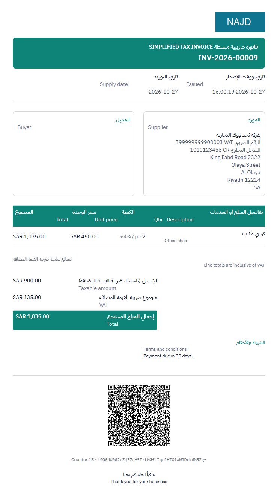
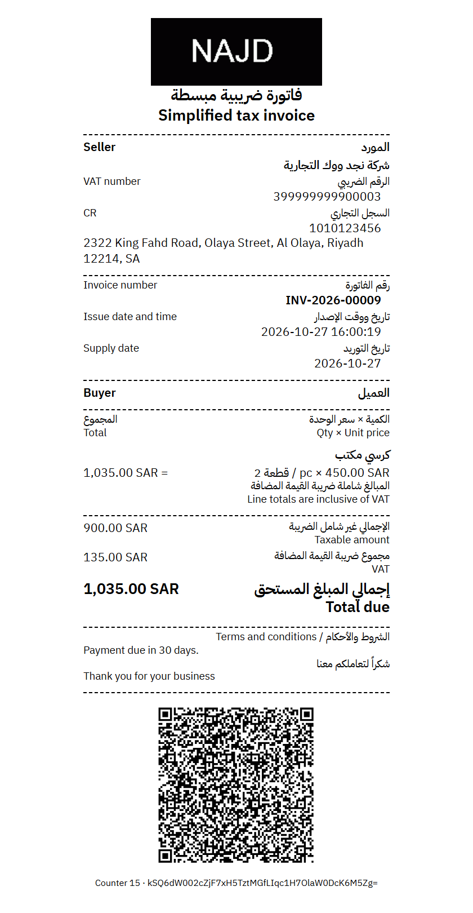
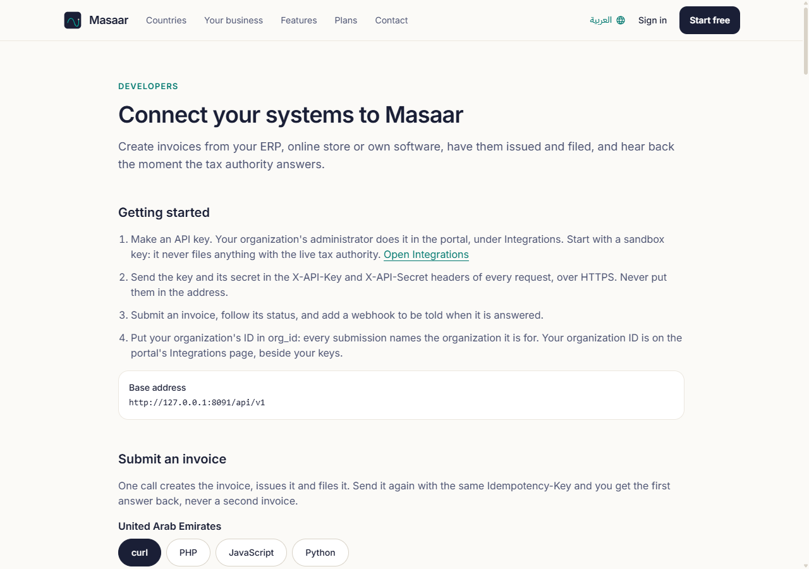
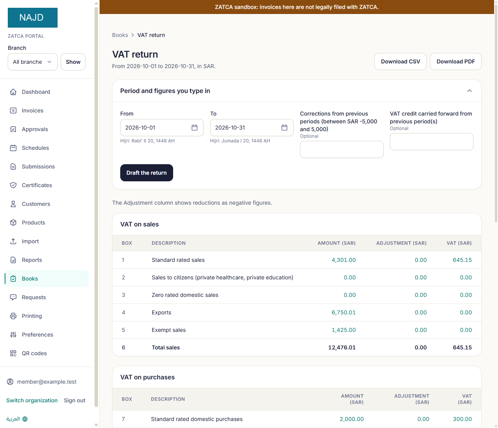
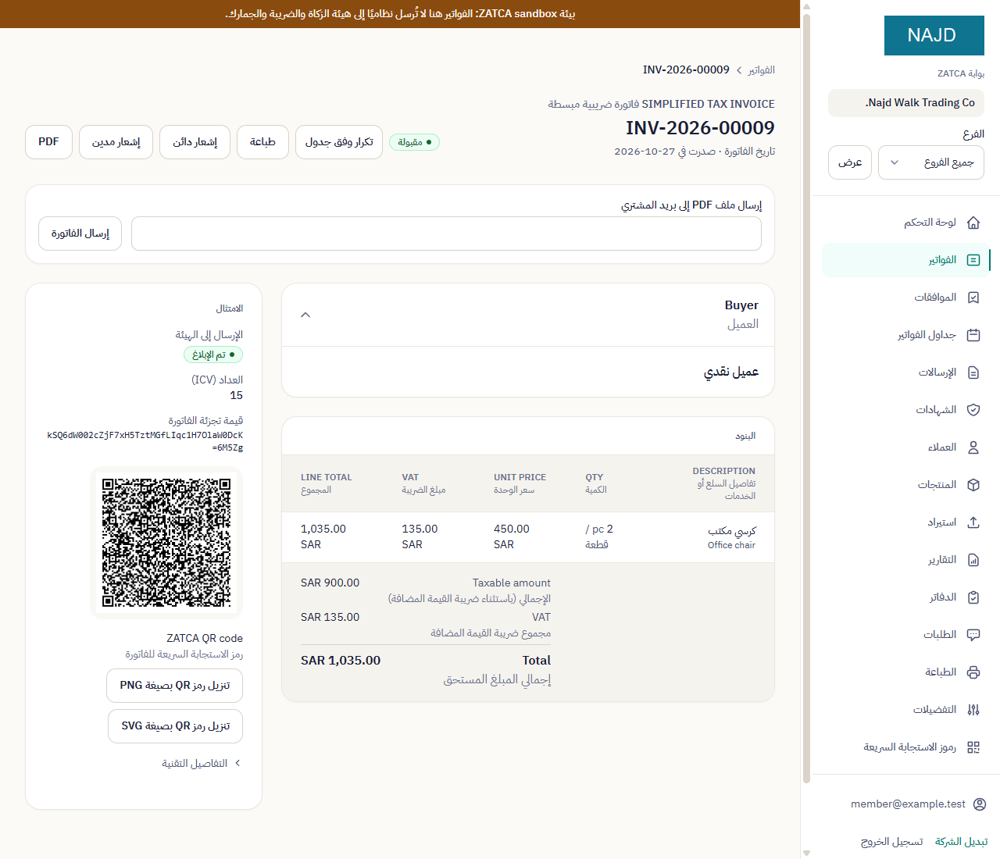
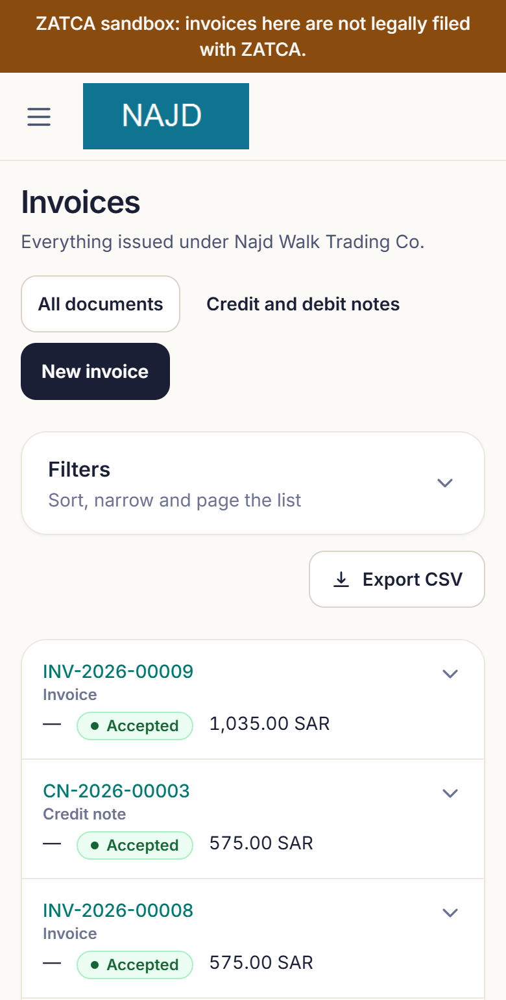

# Features

Audience: business owners, finance managers, IT leads, partners and sales staff comparing solutions.

This page lists what the platform does today, grouped by need. Anything not built yet is marked **planned**. Each country's rules are explained in [Saudi e-invoicing](SAUDI-EINVOICING.md) and [UAE e-invoicing](UAE-EINVOICING.md). The screens are from a fictitious test company in ZATCA's developer sandbox, hence the sandbox banner.

## Compliance

- **Saudi Arabia (ZATCA Fatoora):**
  - Phase 1 invoices with a QR code before you connect to ZATCA.
  - Phase 2 once connected: signed XML, cryptographic stamp, QR code, invoice counter and hash chain.
  - Standard (B2B) invoices are cleared by ZATCA before they reach the buyer. Simplified (B2C) invoices are reported within 24 hours.
- **ZATCA connection from the portal.** Enter the one-time code from the Fatoora portal. The platform obtains the device certificate, passes ZATCA's compliance checks and moves you to production.
- **One certificate per till.** Each branch and till can hold its own ZATCA certificate. You get warnings before a certificate expires, and you renew it in the portal.
- **Rules checked before numbering.** The platform checks ZATCA's business rules before an invoice takes its number. A rejected draft never leaves a gap in your sequence.
- **When ZATCA cannot be reached.** Unsent invoices wait in a queue and are retried automatically. The Late reporting page shows anything past 24 hours, gives you a downloadable record of every attempt, and lets you record that you notified ZATCA.
- **Arabic on Saudi invoices.** Seller and item names must be in Arabic, as ZATCA requires. The platform lists names still missing Arabic.
- **UAE (Peppol PINT AE):**
  - Six document types: tax invoices and credit notes, commercial invoices and credit notes, and self-billed invoices and credit notes.
  - The Ministry's mandatory-field list and the official PINT AE rules are checked before anything is stored.
- **UAE start date and provider.** Before your e-invoicing start date, you issue ordinary tax invoices. From that date, invoices go through the accredited service provider you appointed. You record both on your company page, and the platform reminds you before the appointment deadline.
- **UAE invoices received from suppliers** are kept and listed exactly as they arrived.
- **Credit and debit notes** start from the invoice they correct. Optionally, a second person must approve a note before it is issued, either every note or only notes above an amount you set.

## Invoicing and printing

- Invoice form with running VAT totals, customer and product pickers, and saved drafts.

- **Printing on A4, A5, Letter, 80 mm and 58 mm till rolls.** Each person, organization and branch can choose its own paper. The receipt can also be produced as an image sized for a till printer.
- **PDF invoices** (PDF/A-3). Saudi PDFs carry the signed XML inside them. Once your company is connected to ZATCA's simulation or production environment, each PDF also carries your device's digital stamp (PAdES). In ZATCA's developer sandbox, where every caller shares one test certificate, PDFs come unstamped. You can email the PDF to the buyer from the invoice page.

| A4 invoice | 80 mm till receipt |
|---|---|
|  |  |

- **Invoice links.** A QR code or link opens one issued invoice for the buyer, with no sign-in.
- **Invoice templates and branding.** Your logo and colours, an invoice layout for the organization and for each branch, and a preview before you save.
- **Business QR codes**, for example contact details, a payment page or your location. You can add a second, clearly labelled QR code to invoices, separate from the tax QR code.
- **Recurring invoices and instalment plans**, which you can pause, resume, skip or cancel.
- **Insurance splits** for healthcare: the patient's share and the insurer's share of a sale, and a report of what each insurer owes.
- **Numbering** per document type.
- **CSV imports** for invoices (saved as drafts, never issued automatically), customers and products. Each file is checked row by row before anything is saved.

## Integrations

- **REST API for ERP, billing and point-of-sale systems.** Submit one invoice or a batch and read the status. Send an `Idempotency-Key` header, or an ERP reference on pipeline requests, and a retry returns the first answer instead of filing the invoice twice. Without either, a retry is treated as a new invoice.
- **API keys** that administrators create and revoke in the portal, and a log of recent API requests (without request bodies or secrets).
- **Webhooks**, signed so your system can verify them, for issued, submitted, cleared, reported, warning, rejected and failed invoices, and for expiring certificates. You can send a test event and see each delivery.
- **Public developer page** with a quick start and the full API reference.

## Books and finance

- **Purchases and suppliers.** Enter purchases or import them from CSV. Attach the supplier's file, record payments and write-offs.
- **Receivables.** What each customer owes, payments received, and customer statements as PDF.
- **VAT return draft** built from your sales and purchases, with the detail behind each box. Export as CSV or PDF.
- **Reports.** Sales reports, a VAT summary, an invoice export, a daily close for each device and branch, and companies in a group side by side.
- An **Accountant** role that keeps the books and reads everything else without changing it.

## Team and control

- **Roles:** Owner, Admin, Member (issues invoices), Accountant, and Viewer (read only).
- **Branches.** Each branch has its own address, tills, numbering, printer and staff. You can view one branch or all of them together.
- **Activity log.** Who issued, corrected and changed what, and who invited whom. It can be exported as CSV.
- **Approvals.** No one can approve their own request.
- **Settings at three levels.** A platform default, your organization's value, and each person's own preference.
- **Saved views** on lists, with sorting and filters.
- **Support desk** inside the portal for help, customization requests and feature requests. A shared feature board, open to signed-in customers, lets you back the requests you need.

## Bilingual and mobile

- The whole portal works in Arabic (right to left) and English. You can switch at any time, and emails follow your language.
- Layouts adapt to phones and tablets, and the portal can be added to a phone's home screen. There is no separate mobile app.

| Arabic | Phone |
|---|---|
|  |  |

## Security

Two-factor sign-in, and an organization can require it for every member. See [Security and trust](SECURITY-AND-TRUST.md) for encryption, keys, backups and data location.

## Planned

- **Offline edge node for store counters**, so tills keep issuing during an internet outage. Today, invoices that cannot reach the authority are queued on the platform, but the till itself needs a connection to the platform.
- **Card payment of the platform's own invoices.** The payment flow is built behind a switch and tested against a simulated card gateway. No live card gateway is connected yet, so today you pay by bank transfer.
- Live connection to a UAE accredited service provider. The connection is built and tested against a simulated provider.
- Turning UAE invoices received from suppliers into purchase records.
