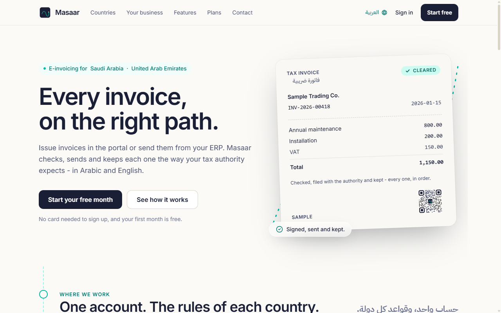
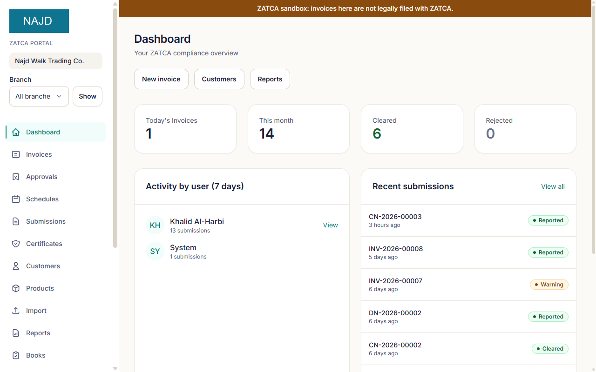
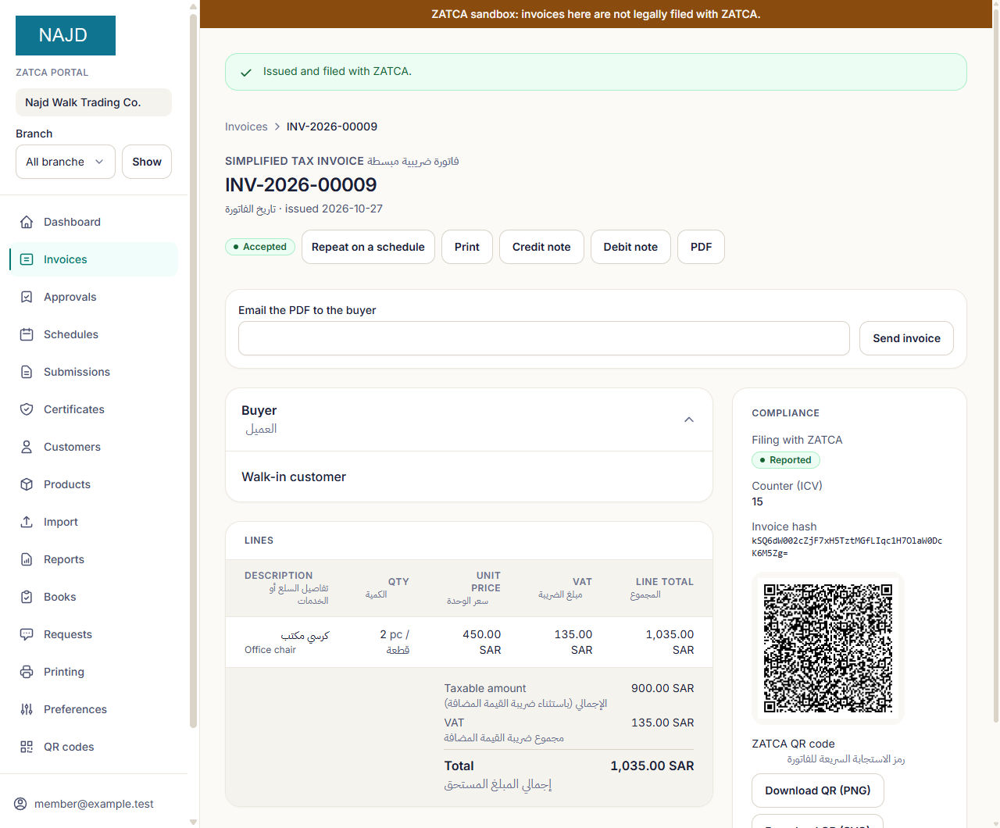

# The platform at a glance

Audience: business owners and decision makers, and the sales staff and partners who talk to them.

## What it is

A hosted e-invoicing platform for businesses in **Saudi Arabia** and the **United Arab Emirates**. It issues invoices that meet each country's e-invoicing rules and connects them to the tax authority's system. Your team uses a web portal in Arabic and English. Your ERP or point-of-sale system can connect through an API. Your accountant can keep the books in the same place.

You do not have to set it up alone. We set it up with you: company details, the connection to the authority, branches and tills, printing, and any links to your other systems.

## Who it is for

Any VAT-registered business that must issue electronic invoices, with ready-made starting settings for:

- **Retail and supermarkets**: fast receipts on 80 mm till paper, and a daily close for each device.
- **Pharmacies, clinics and hospitals**: a sale split between the patient and an insurer, with what each insurer owes.
- **Schools**: fees billed each term, and instalment plans.
- **Services firms**: monthly recurring invoices.
- **Wholesalers, manufacturers, exporters and government suppliers**: business-to-business (standard) invoices on A4 paper.
- **E-commerce**.
- **Groups and institutions**: several companies or branches, reported together or one by one.

## The problem it solves

- **The law requires it.** In Saudi Arabia, every VAT-registered business must issue invoices from a compliant electronic solution. In the Integration Phase (Phase 2), each invoice must also be cleared by, or reported to, ZATCA's Fatoora platform. In the UAE, businesses in scope must issue and receive invoices through an accredited service provider, in phases by revenue.
- **Mistakes cost money.** Both authorities can impose penalties when invoices are wrong, late or missing. A refused invoice can also hold up payment from your customer.
- **It takes technical work.** Digital signatures, device certificates, QR codes, invoice counters and hash chains in Saudi Arabia. Structured XML, Peppol identifiers and a service provider in the UAE. Most businesses do not want to build this themselves.

## How it works, in four steps

1. **Sign up and tell us about your business.** Your company, branches and the type of business you run. The platform suggests matching settings: invoice type, paper size, and whether prices include VAT.
2. **Connect to the authority.** In Saudi Arabia you generate a one-time code (OTP) in the Fatoora portal and the platform obtains your device certificate. In the UAE you record your e-invoicing start date and the service provider you appointed.
3. **Issue invoices.** Use the portal, import a CSV file, or send invoices from your ERP or till through the API. Each invoice is checked against the authority's rules *before* it is numbered, then signed, cleared or reported, and filed.
4. **Stay on top of it.** The dashboard shows what was filed, what is waiting and what needs attention. You also get alerts for certificate expiry and late reporting, VAT reports, and the full history of who did what.

## What it looks like

The screens below are from a fictitious test company in ZATCA's developer sandbox, so a banner says nothing there is legally filed.

More screens are in [Features](FEATURES.md).

## Why us

- **Checked against the authority's own tools.** ZATCA's validator and developer sandbox in Saudi Arabia ([where things stand](SAUDI-EINVOICING.md#where-things-stand)); the official PINT AE validation rules in the UAE.
- **Refused before, not after.** Rules are checked before an invoice takes its number, so a mistake never leaves a gap in your numbering.
- **Arabic and English throughout.** The portal, emails and printed invoices.
- **One place for invoicing and books.** Purchases, what customers owe, statements, and a draft of the VAT return.
- **Set up with you.** A guided setup and a support desk inside the portal.

## How to start

Write to **shamil3ilm@gmail.com**. Tell us your country, your type of business, how many branches and tills you have, and which systems you use today. We will book a walkthrough and agree a plan. New customers get their first month free. Pricing is agreed per customer; there is no fixed price list.

More detail: [Features](FEATURES.md) · [Objections](OBJECTIONS.md) · [Pilot proposal](PILOT-PROPOSAL.md) · [Saudi e-invoicing](SAUDI-EINVOICING.md) · [UAE e-invoicing](UAE-EINVOICING.md) · [Security and trust](SECURITY-AND-TRUST.md) · [FAQ](FAQ.md) · [Glossary](GLOSSARY.md)
